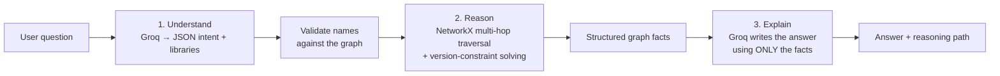

# 🕸️ Software Dependency & Compatibility Graph

A lightweight **Knowledge-Augmented Generation (KAG)** project that answers multi-hop questions about
software dependencies and compatibility. A hand-curated knowledge graph does the reasoning; an LLM
turns the results into a clear answer.

> *"What breaks if I upgrade numpy to 2.0?"* → the graph finds that `tensorflow` pins `numpy<2.0`,
> that `keras` depends on `tensorflow`, and Groq explains the impact and what to do about it.

<!-- Add screenshots here, e.g.:


-->

---

## Why KAG instead of plain RAG or just asking an LLM?

- Dependency questions are **structured and multi-hop**: the answer depends on chains of relationships and on version arithmetic, which LLMs often get wrong when left to guess.

| Approach | Problem |
|---|---|
| LLM alone | Invents versions and constraints that don't exist |
| Text-chunk RAG | Retrieves paragraphs, but can't walk `A → B → C` or intersect version ranges |
| **KAG (this project)** | Deterministic code traverses the graph and solves constraints; the LLM only *explains* verified facts |

---

## Features

- **Knowledge graph** of 32 libraries and 58 relationships, built with NetworkX
- **Five relation types:** `depends_on`, `conflicts_with`, `recommended_with`, `compatible_with`, and version constraints (stored on edges as PEP 440 specifiers)
- **Multi-hop reasoning:**
  - *Upgrade impact:* direct breakages, transitive "at risk" chains, and how other mentioned libraries relate
  - *Requirements:* transitive dependency closure plus a suggested install set
  - *Compatibility:* intersects every version constraint per package and reports conflicts
- **AI question understanding:** Groq extracts intent, libraries and versions from loosely worded questions, then every name is validated against the graph, so the model cannot invent nodes. Falls back to keyword rules if the call fails
- **Transparent answers:** show the exact graph facts and a subgraph drawing behind each response
- **Graph explorer:** pick a library, choose 1–3 hops, filter by relation type, and inspect the edges in a table
- **Live model list:** the model dropdown is fetched from Groq, so it doesn't go stale when models are retired

---

## How it works



1. **Understand:** an LLM call converts the question into `{intent, libraries[{name, version}], features}`.
   Output is validated against the graph; invalid or unknown names are dropped.
2. **Reason:** plain Python walks the graph and checks versions with the `packaging` library. No LLM involved.
3. **Explain:** the labelled facts (`BREAKS`, `AT RISK`, `CONFLICT`, `RESOLVED`, `CONTEXT`, `PATH`) are passed to Groq with
   a strict prompt: use only these facts, cite relationships, never invent versions.

### Example

**Question:** `Is streamlit compatible with tensorflow?`

**Graph facts (excerpt):**
```
CONFLICT protobuf: >=4.25,<6 (from streamlit); >=3.20,<4.25 (from tensorflow) -> NO known version satisfies all of these
RESOLVED numpy: >=1.20,<3 (from streamlit); >=1.23,<2.0 (from tensorflow) -> viable ['1.24', '1.26'] -> pick 1.26
```

**Answer:** not compatible in this graph, because their `protobuf` ranges don't overlap.

### Example questions

- What breaks if I upgrade numpy to 2.0?
- What breaks if I upgrade starlette to 0.40?
- I want a web api and a dashboard together. What do I need?
- Is streamlit compatible with tensorflow?
- Are fastapi and pydantic compatible if I also use langchain?
- Will bumping sklearn to 1.5 wreck my pandas setup?

---

## Project structure

```
dep-graph-kag/
├── app.py               # Streamlit UI: chat + graph explorer
├── graph_builder.py     # Loads the JSON into a NetworkX MultiDiGraph
├── reasoning.py         # Entity linking, multi-hop logic, constraint solver, intent router
├── llm.py               # Groq calls: question understanding + answer generation
├── graph_viz.py         # Matplotlib subgraph drawing (ring layout, legend, labels)
├── data/
│   └── graph_data.json  # Nodes, features and edges (hand-curated)
├── requirements.txt
└── README.md
```

---

## Getting started

### Prerequisites
- Python 3.9+
- A free [Groq API key](https://console.groq.com/keys)

### Install and run

```bash
# 1. (optional) create a virtual environment
python -m venv .venv
source .venv/bin/activate        # Windows: .venv\Scripts\activate

# 2. install dependencies
pip install -r requirements.txt

# 3. provide your API key (or paste it into the app sidebar)
export GROQ_API_KEY=gsk_your_key_here     # Windows PowerShell: $env:GROQ_API_KEY="gsk_..."

# 4. launch
streamlit run app.py
```

The app opens at `http://localhost:8501`.

### Using the app

| Control | What it does |
|---|---|
| **Model** | Models available to your key, fetched live from Groq (defaults to `openai/gpt-oss-120b` when available) |
| **AI question understanding** | On: LLM extracts intent and libraries. Off: keyword rules only |
| **Show reasoning path** | Shows the graph facts and a subgraph drawing under each answer |
| **Clear chat** | Resets the conversation |
| **Explore graph tab** | Browse any library's neighbourhood by hops and relation type |

---

## Extending the graph

Edit `data/graph_data.json`. No code changes are needed.

**Add a library:**
```json
{"id": "polars", "category": "data", "versions": ["0.19", "0.20", "1.0"], "aliases": []}
```

**Add relationships** as `[source, relation, target, constraint, note]`:
```json
["polars", "depends_on", "python", ">=3.8", ""],
["polars", "recommended_with", "pandas", "", "Interchange via Arrow"],
["polars", "conflicts_with", "somelib", "", "Why they clash"]
```

- `constraint` is a [PEP 440](https://peps.python.org/pep-0440/) specifier (e.g. `>=1.23,<3`) applied to the **target's** version. Leave it empty for no constraint.
- `versions` is the list of versions the solver may pick from.
- Add a feature phrase (e.g. "data frames" → `pandas`) under `features` to support requests like *"I want a web api and a dashboard"*.

---

## Limitations

- **The data is illustrative.** It is hand-written and simplified, and includes one intentional conflict (`tensorflow` vs `streamlit` on `protobuf`) so the demo has something to detect. Do not use it to pin real production dependencies.
- **One constraint per edge.** The graph cannot yet express "pandas 2.2 needs numpy ≥1.26 but pandas 1.5 doesn't".
- **Version-aware, not changelog-aware.** It knows declared ranges, not API-level breaking changes.
- **Small scale.** Designed for clarity at ~30 nodes. For thousands of packages you would want real data and a graph database.

## Roadmap ideas

- Import real dependency metadata from PyPI
- Per-version edges
- Automated tests for the reasoning layer (e.g. *numpy 2.0 breaks tensorflow*)
- Export an install set as `requirements.txt`

---

## Troubleshooting

| Problem | Fix |
|---|---|
| `model_not_found` (404) from Groq | The selected model isn't available to your key. Pick another from the dropdown |
| `ImportError: cannot import name ...` | A file is out of sync. Make sure `app.py`, `llm.py`, `reasoning.py` and `graph_viz.py` are all the latest versions |
| `StreamlitAPIException: set_page_config` | `st.set_page_config(...)` must be the first Streamlit call in `app.py` |
| Answer says "understood by: rules" | The AI understanding step failed or is turned off. Check the toggle and use a stronger model |
| "No Groq key" message | Paste a key in the sidebar or set `GROQ_API_KEY` before launching |

---

## Tech stack

- [Python](https://www.python.org/)
- [NetworkX](https://networkx.org/): knowledge graph and traversal
- [packaging](https://packaging.pypa.io/): PEP 440 version and specifier handling
- [Groq](https://groq.com/): LLM inference
- [Streamlit](https://streamlit.io/): UI
- [Matplotlib](https://matplotlib.org/): graph drawing

---

## Contributing
- Contributions are welcome.
1. Fork the repository and create a branch: git checkout -b feature/your-feature
2. Make your changes and keep them focused on one topic.
- `streamlit run app.py` still run.
3. Commit with a clear message and open a pull request describing what changed and why.
4. Please open an issue first for larger changes, and include steps to reproduce when reporting a bug.


## License
- This project is licensed under the MIT License.
- MIT License
```
Copyright (c) 2026 Melisa Sever

Permission is hereby granted, free of charge, to any person obtaining a copy
of this software and associated documentation files (the "Software"), to deal
in the Software without restriction, including without limitation the rights
to use, copy, modify, merge, publish, distribute, sublicense, and/or sell
copies of the Software, and to permit persons to whom the Software is
furnished to do so, subject to the following conditions:

The above copyright notice and this permission notice shall be included in all
copies or substantial portions of the Software.

THE SOFTWARE IS PROVIDED "AS IS", WITHOUT WARRANTY OF ANY KIND, EXPRESS OR
IMPLIED, INCLUDING BUT NOT LIMITED TO THE WARRANTIES OF MERCHANTABILITY,
FITNESS FOR A PARTICULAR PURPOSE AND NONINFRINGEMENT. IN NO EVENT SHALL THE
AUTHORS OR COPYRIGHT HOLDERS BE LIABLE FOR ANY CLAIM, DAMAGES OR OTHER
LIABILITY, WHETHER IN AN ACTION OF CONTRACT, TORT OR OTHERWISE, ARISING FROM,
OUT OF OR IN CONNECTION WITH THE SOFTWARE OR THE USE OR OTHER DEALINGS IN THE
SOFTWARE.
```